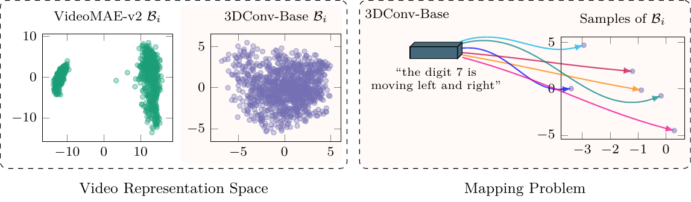

<h1 style="text-align: center;">On the Analysis of the One-to-Many Mapping in Cross-Modality Text-to-Video Generation with Semantic Spaces</h1>
<div style="text-align: center;">
  <span class="author-block">
    Karina O. M. Bogdan<sup>1*</sup>,</span>
  <span class="author-block">
    Adín Ramírez Rivera<sup>2†</sup>,</span>
</div>
<div style="text-align: center;">
  <span class="author-block"><sup>1</sup>Institute of Computing, University of Campinas (Unicamp),</span>
  <span class="author-block"><sup>2</sup>Department of Informatics, University of Oslo</span>
</div>


## Abstract 

Despite recent advances in text-to-video generation, the role of text and video latent spaces in learning a semantically shared representation remains underexplored. In this cross-modality generation task, most methods rely on conditioning the video generation process by injecting the text representation into it, rather than exploring the implicit shared knowledge between the modalities. However, the feature-based alignment of both modalities is not straightforward, especially for the one-to-many mapping scenario in which one text can be mapped to several valid semantically aligned videos, a challenge that generally produces a representation collapse in the alignment phase.
In this work, we investigate and give insights into how both modalities cope in a shared semantic space where each modality representation is previously learned in an unsupervised way. We explore this from a latent space learning perspective with a plug-and-play framework that adopts autoencoder-based models that could be used with other representations. 
We show that the one-to-many case requires different alignment strategies than those commonly used in the literature, which struggle to align both modalities in a semantically shared space.

<p style="text-align: center;">
  
</p>


### Environment Setup

A docker image is available [here](docker). For environments managed by Slurm, this docker image is converted to .tar and then to .sif (Apptainer), such as in:
```bash
docker save image_name -o image_name.tar
apptainer build image_name.sif docker-archive://image_name.tar
```

#### IQA Metrics

To correctly use the official DISTS implementation, which has an issue in its weights path, consider a change in the `DISTS/DISTS_pytorch/DISTS_pt.py` by adding at the top:

```python
import pkg_resources
from pathlib import Path

my_file = pkg_resources.resource_filename('DISTS_pytorch', 'weights.pt')
print(my_file)
print(Path(my_file).exists())
```

and at the call to the files in the class constructor:

```python
if load_weights:
    weights = torch.load(str(my_file))
    self.alpha.data = weights['alpha']
    self.beta.data = weights['beta']
```

Then, install again inside container at `/work/DISTS`with `pip install -e . --config-settings editable_mode=compat`.


#### Additional Packages

- `vidutils` for inference and testing metrics

```bash
pip install -e vidutils
# In DISTS_pytorch, as in the example below
# Make sure the change for the weights.pt is considered
pip install -e . --config-settings editable_mode=compat
```

### Inference

The inference scripts are composed of the test scripts that generate the inference data and the metrics, represented by scripts calculating the quantitative metrics along with a brief report.

- Inference: `test_*.py` scripts at `text2video/tools` that generate inference data for both video representation models and alignment models (codes, videos, etc)
- Metrics: shell scripts at `shellscripts` containing examples of the pipelines to generate the metrics. The requirements for this part is the docker image of the VQA package located at `vqa/docker/Makefile`, which is based on [https://github.com/google-deepmind/kinetics-i3d](https://github.com/google-deepmind/kinetics-i3d). 

### Processed Data Sets

The following processed data sets in TF records format are available [here](https://drive.google.com/drive/folders/19KtKADp5rTcdjsrzdF_5oXeP03Oe3_6e?usp=sharing):
- SyncDraw: Built over the 50,000 handwritten digits of MNIST, were the initial position is generated randomly with the script in the following link
https://github.com/Singularity42/Sync-DRAW/blob/master/dataset/mnist_caption_single.py
- KTH
- TACoS


### Citation

If you find our work helpful, please consider citing:

```
@article{Bogdan2026_T2VAlignment,
    title={On the Analysis of the One-to-Many Mapping in Cross-Modality Text-to-Video Generation with Semantic Spaces},
    author={Karina O. M. Bogdan and Adín Ramírez Rivera},
    journal={Transactions on Machine Learning Research (TMLR)},
    year={2026},
    url={https://openreview.net/forum?id=Khl7xjzTak},
}
```

### TODOs

- [ ] Upload Checkpoints
- [ ] Training scripts
- [ ] Data processing scripts
